<p align="center">
  
</p>

<h1 align="center">Orbit Sports</h1>

<p align="center">
  <b>Every game, live.</b><br>
  <a href="https://orbit.jaypengx.com/app/"><b>Use it in Orbit</b></a> · on its own at <a href="https://orbit.jaypengx.com/sports/">orbit.jaypengx.com/sports</a>
</p>

<p align="center">
     
</p>

Scores, schedules and stats for the leagues you can watch in Taiwan, with a plan for your day and one tap to watch. Part of **Orbit**, a family of apps for life in Taiwan that share one sign-in, the Orbit Pass.

> **Best in Orbit.** Add [Orbit](https://orbit.jaypengx.com/app/) to your home screen: every Orbit app in one, signed in once, switching between them without reloading. Orbit Sports also works on its own at [orbit.jaypengx.com/sports](https://orbit.jaypengx.com/sports/) if it's the only one you want.

<p align="center">
  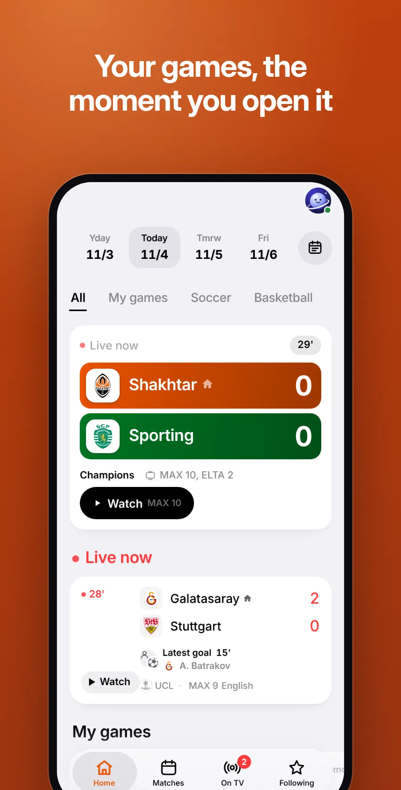
  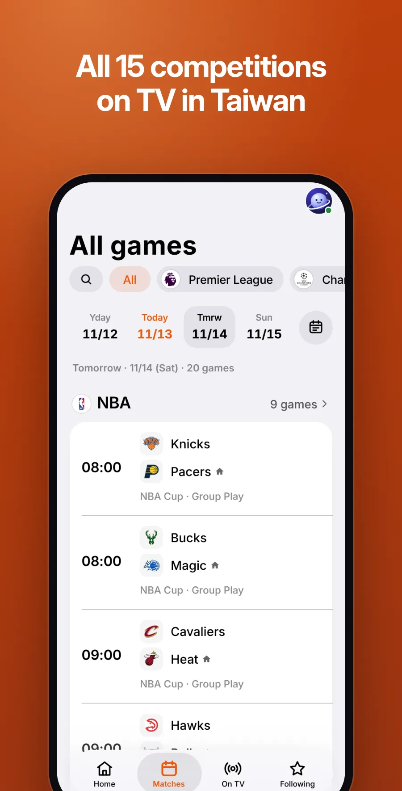
  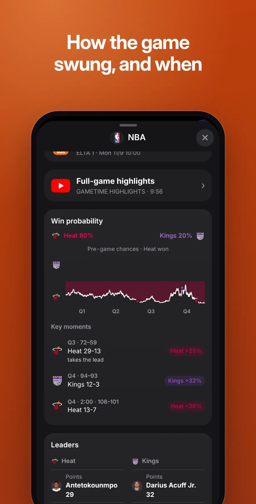
</p>

<p align="center">
  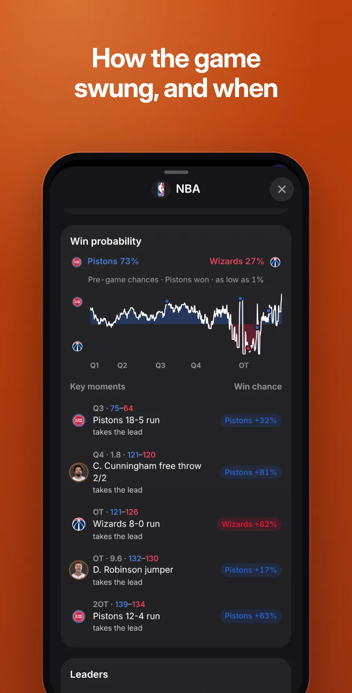
  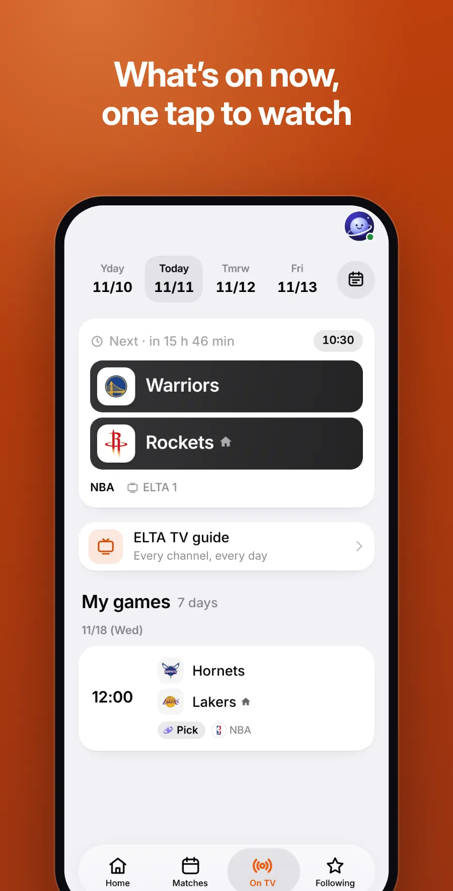
  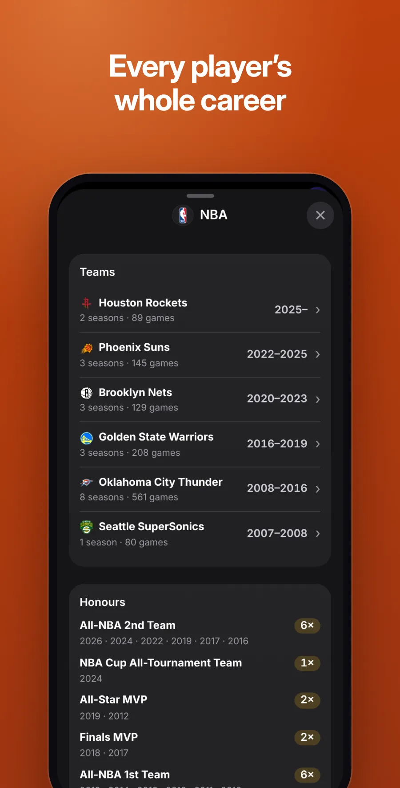
</p>

<details>
<summary>中文畫面</summary>

<p align="center">
  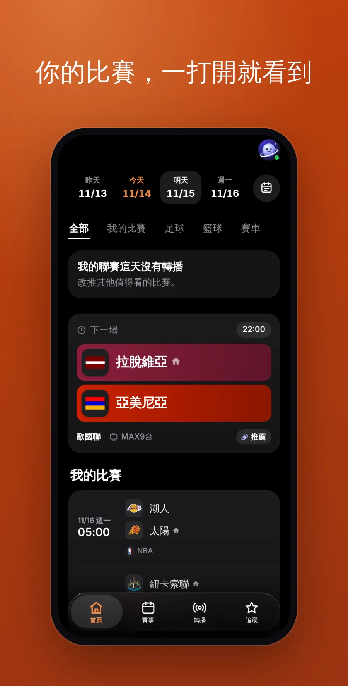
  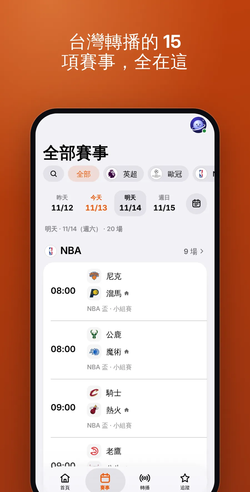
  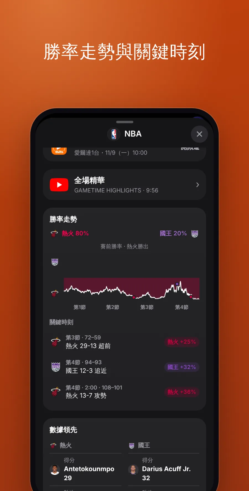
</p>

<p align="center">
  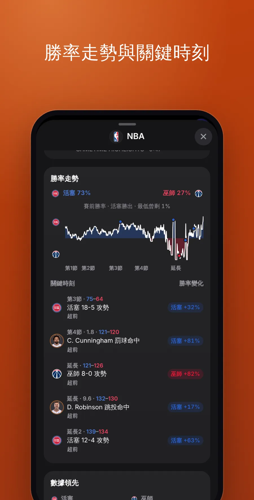
  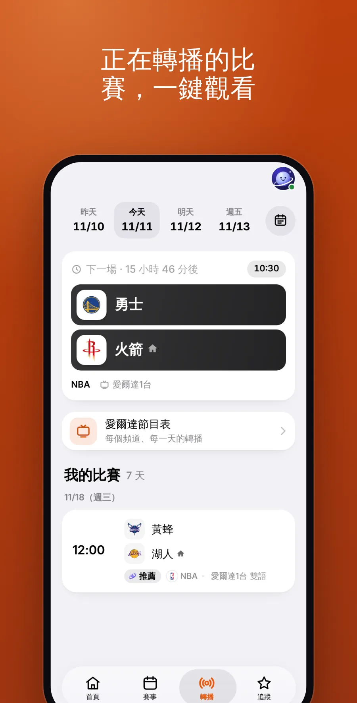
  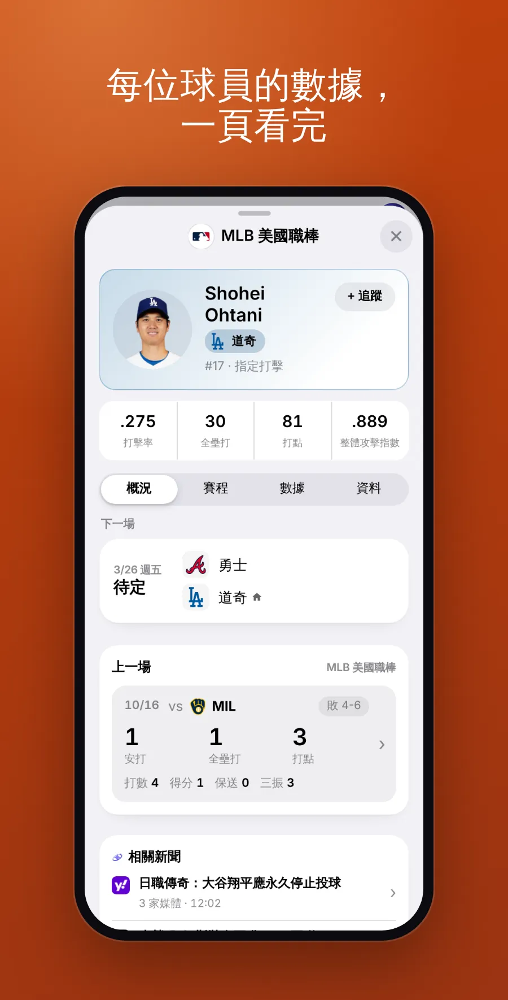
</p>

</details>

## Features

- **Orbit AI** (its mark on everything smart): 問比賽 asks about the teams you follow and answers as tables the app read (places, next and last games, today) with each team's logo and one AI line; a finished game's 賽後三句話 says only what the card doesn't (comebacks, runs, the period that broke it open), players as face chips and teams as logo chips; each F1 race's 勝負關鍵 as rows, a lap and a driver's face each; 看點 says why a game to come matters. Lines everyone reads are made when someone taps for them, then kept for everyone.
- **With the family:** a CPBL game near at hand opens Orbit Transit's trip to the park with the park's weather (去球場); a live NBA game counts each side's timeouts left.
- **Today:** a sticky date strip, what's on now, a no-clash plan of the day's best games, your own teams' games, and what already finished (推薦給你 apart from 其他比賽). Each hour's pick stays as it stood before its games.
- **Only what you can watch here:** MLB and CPBL, the NBA, the Premier League, Serie A, Bundesliga, Ligue 1, the UEFA cups, MLS on Apple TV, and every F1 session. A league out of season hides itself.
- **One shape for every page:** a game, a team, a player and a league open the same way, with the competitions as chips (a team's 英超, 聯賽盃 and 歐冠 apart, or 全部).
- **Player careers:** the draft, debut, years and college, every team with its years, seasons and games (loans too), honours, and season by season, for NBA, MLB, football and F1 drivers; a team's row opens that team.
- **Match pages:** live score and line score, a win-chance chart with key moments, line-ups, box score, play by play, injuries, standings and season leaders, ordered by the moment of the game. A live game is told stoppage by stoppage with its runs, fair key moments and the table as it stands; a basketball player's season opens in depth (points a game, shooting, splits).
- **F1 live board:** F1's own timing in tabs (order, track, tyres, lap times, points), every car moving on the track map, race control in Chinese.
- **Live tables:** standings count results the moment a game ends, with a title line ("前 8 名，或 Russell、Hamilton 都沒贏") and magic numbers; clinch cards name the head-to-head games still to come and what each side needs; sides level are ordered by their league's own tiebreaks (同分怎麼排 under each table says which step settled each pair); each table's key says what a faded row (no chance left, MLS: 已無緣季後賽外卡) and a lock (名次已確定) mean.
- **Playoffs:** real brackets, or ones predicted from the table while the season runs; a game's 排名 holds its 季後賽, NBA 盃 (all six groups and the knockout) and the table as chips. The NBA Cup settles level teams the league's way (head-to-head, point differential, total points, last season's record, the draw) and says why under each group.
- **Where to watch:** ELTA's own schedule (exact channel and commentary), NBA.com's ELTA list and Apple TV's MLS pages, plus replays and highlights.
- **今日推薦** learns what you open and what you pass over (kept on the phone for 30 days).
- **Follow** teams, players, leagues and drivers (我的聯賽 at the top of 追蹤); get a notice when a game starts or ends, even with the app closed.
- **Chinese first**, English second; teams in Chinese, players in their own names.
- **Every screen, either way up:** on a phone on its side, a tablet or a computer each tab is two columns (首頁's answer beside what's next, 賽事's leagues side by side), and a game's cards, line-ups and both tables stand side by side.

## Tech stack

| Layer | What |
| --- | --- |
| App | Plain JavaScript (ES modules), HTML and CSS; no framework, no build step, no dependencies |
| Platform | Installable web app (Add to Home Screen) with a service worker; phones from 320 to 440 px |
| Shared | The look, the Orbit Pass sign-in, notices and data reads come from the kit in [Orbit-Core](https://github.com/JayPengX/Orbit-Core) |
| Data | ESPN, MLB's API, CPBL, F1 timing, Jolpica, FotMob and ELTA, all through the Orbit proxy on Cloudflare Workers; seasons and finished games kept in Cloudflare R2 |
| Hosting | Cloudflare (static files), at orbit.jaypengx.com |
| Tests | `node --test` (about 50 test files on the logic: tables, picks, playoffs, F1, live state) |

## How it works

```
phone ── public/ (this repo, on Cloudflare) + the kit (Orbit-Core's, on Cloudflare)
  │  kit proxyJson: memory → the phone's cache → R2 packs → the proxy's edge cache → upstream
  ▼
api.jaypengx.com (Cloudflare Worker) ── ESPN · MLB · CPBL · F1 timing · FotMob · ELTA · …
```

- **One rule, one function.** A game's state (`sessionStatus`, `overByRule`) and the live table (`lib/title.mjs liveTable`) are each one function that every screen reads, so the home card, the TV guide and the standings never disagree.
- **Refresh in place.** Lists refresh every 5 s, an open game every 3 s, F1 every 4 to 15 s; values change in place, the page never redraws.
- **Picks** (`lib/picks.mjs`) weigh the leagues and teams you follow, closeness, stakes and what's on TV, then pick the best game and the best that doesn't clash.
- **Offline:** the app says it's offline rather than show old scores as live.

The full map, file by file, and the decisions still in force: **[MAP.md](MAP.md)**.

## Project structure

```
public/
├── index.html, app.js     the tabs, follows, days, picks, notices, live ticks
├── sheets.js              every sheet: match, race weekend, team, player, tables
├── cards.js, ui.js        cards, tiles and DOM helpers
├── styles.css             the app's own look on top of the kit's
├── lib/                   37 modules: ESPN reads, F1, tables and title race,
│                          playoffs, leaders, picks, TV, win chance, live state
├── sw.js                  the service worker (the kit's, with this app's settings)
└── icons/, share/, img/   icons and share cards
scripts/                   NBA-on-ELTA list, ESPN label audit, version stamp
tests/                     node --test
MAP.md                     how it works, file by file
```

## Getting started

The app loads the shared kit from a sibling folder, so clone this repo next to [Orbit-Core](https://github.com/JayPengX/Orbit-Core):

```bash
git clone https://github.com/JayPengX/Orbit-Core.git
git clone https://github.com/JayPengX/Orbit-Sports.git
cd Orbit-Sports
```

Requirements: Node.js 22 or newer. There is nothing to install: no framework, no `node_modules`.

```bash
npm test   # links ../Orbit-Core/kit as .kit, then runs node --test
```

See it on a phone-sized screen, signed in with a made-up wallet and real data (needs Playwright):

```bash
# a screenshot, saved in /tmp/orbit-preview
node ../Orbit-Core/tools/preview.mjs sports --live --width 375
# serve it, then open http://localhost:8123/Orbit-Sports/
node ../Orbit-Core/tools/preview.mjs sports --live --serve --port 8123
```

`--dark`, `--lang en`, `--webkit` (Safari's engine) and the other flags are listed in [Orbit-Core/tools/README.md](https://github.com/JayPengX/Orbit-Core/blob/main/tools/README.md).

`node scripts/label-audit.mjs` lists any ESPN stat label still missing a Chinese name.

## Deploying

Push to `main`. GitHub Actions runs the tests, writes `nba-elta.json`, stamps every file with its content hash (so a phone downloads only what changed) and publishes `public/` to Cloudflare at its orbit.jaypengx.com address (Orbit-Core `deploy/cf-site.mjs`). It also runs every 6 hours. There are no pull requests or release branches.

## Part of Orbit

Every app below is in **[Orbit](https://orbit.jaypengx.com/app/)**, one home-screen app for them all; each also works on its own.

| App | What it is |
| --- | --- |
| [Orbit Sports](https://github.com/JayPengX/Orbit-Sports) | Every game you can watch in Taiwan, live |
| [Orbit Transit](https://github.com/JayPengX/Orbit-Transit) | Bus, train, metro and YouBike, planned and navigated |
| [Orbit Weather](https://github.com/JayPengX/Orbit-Weather) | One clear forecast, to the township |
| [Orbit Words](https://github.com/JayPengX/Orbit-Words) | English vocabulary that stays |
| [Orbit Securities](https://github.com/JayPengX/Orbit-Securities) | A Taiwan broker on play money |
| [Orbit Class](https://github.com/JayPengX/Orbit-Class) | Today's classes at a glance |
| [Orbit Beats](https://github.com/JayPengX/Orbit-Beats) | Endless music and your own beats |
| [Orbit Law](https://github.com/JayPengX/Orbit-Law) | Laws, rulings and bills, linked |
| [Orbit Money](https://github.com/JayPengX/Orbit-Money) | Your own books |
| [Orbit-Core](https://github.com/JayPengX/Orbit-Core) | The kit, the Orbit Pass and the Workers behind them all |

How it was all built, in pictures and numbers: [jaypengx.com/showcase](https://jaypengx.com/showcase/).
